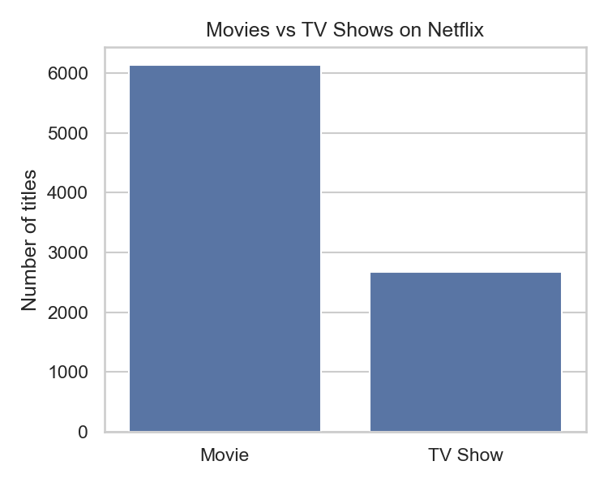
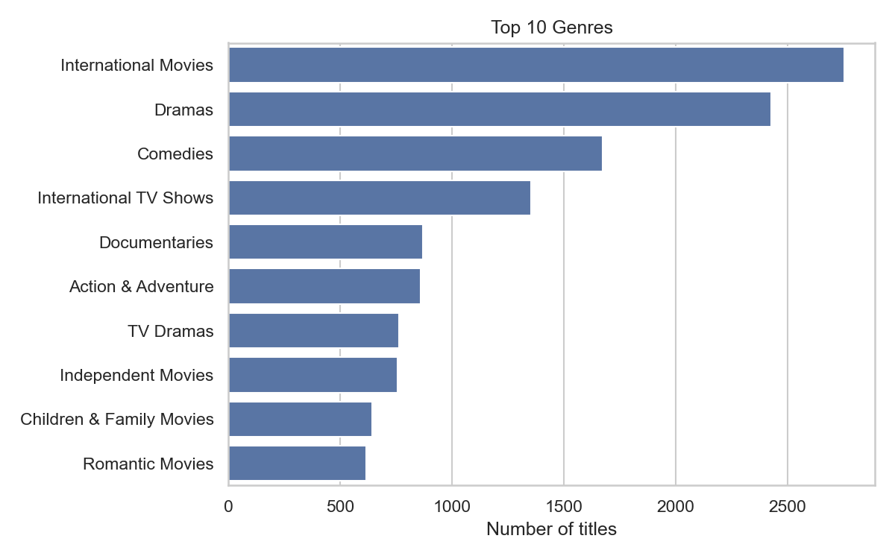
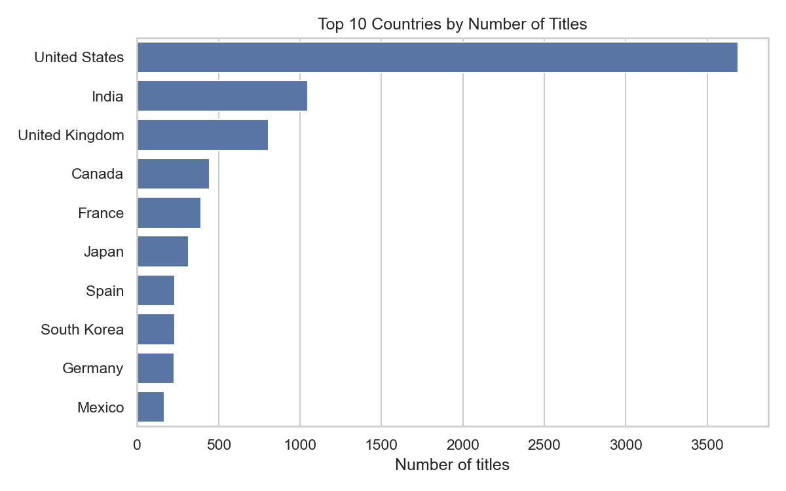
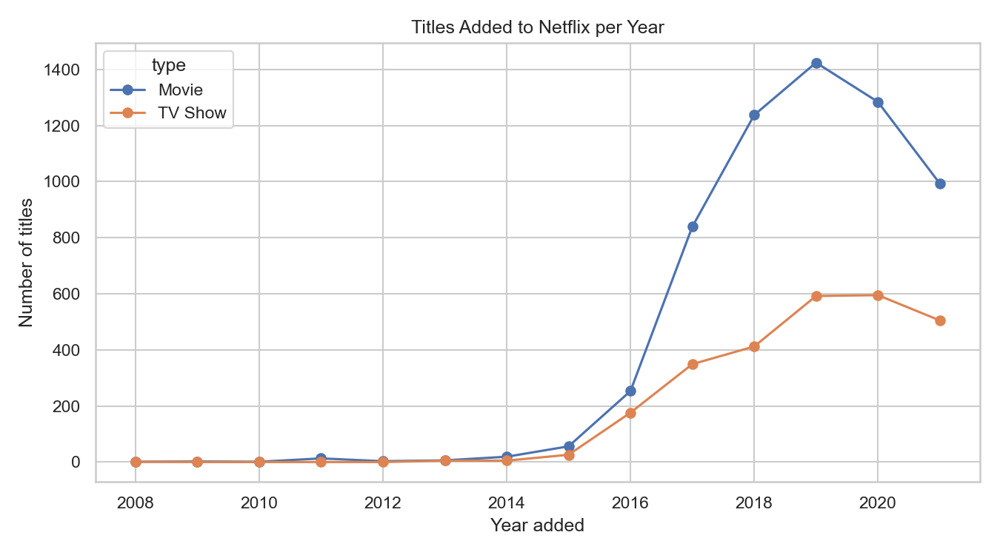
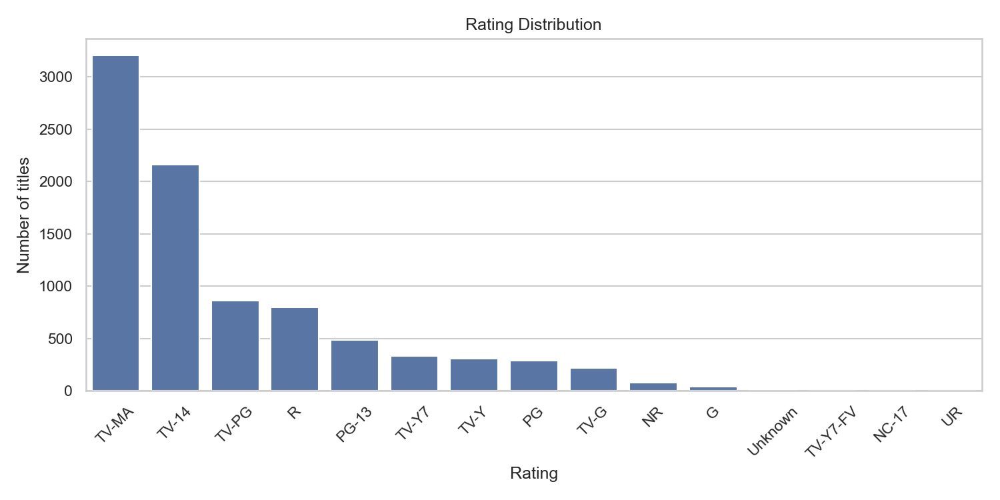
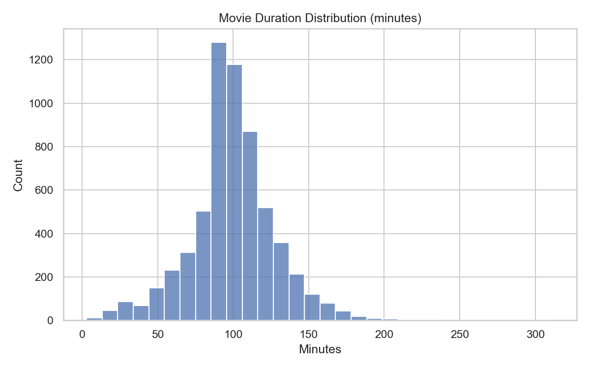

# Netflix Data Analysis

Exploratory data analysis of 8,800+ Netflix movies and TV shows using Python, Pandas, Matplotlib, and Seaborn.

## Dataset
Netflix Movies and TV Shows dataset from Kaggle (`netflix_titles.csv`): title, type, director, cast, country, date added, release year, rating, duration, and genres.

## Questions Answered
- How is the catalog split between movies and TV shows?
- Which genres and countries produce the most content?
- How has the number of titles added changed over time?
- What are the most common ratings?
- How long is the average movie?

## Data Cleaning
- Filled missing director, cast, and country values with "Unknown"
- Fixed rows where duration was stored in the rating column
- Converted `date_added` to datetime and extracted year and month
- Split duration into number and unit (minutes vs seasons)
- Split multi-value genre and country columns for accurate counts

## Key Findings
- Netflix's catalog of 8,807 titles is 69.6% movies (6,131) and 30.4% TV shows (2,676)
- International Movies is the largest genre with 2,752 titles
- The United States leads content production with 3,690 titles
- Content additions peaked in 2019
- TV-MA is the most common rating, so the catalog leans toward mature audiences
- The average movie runs about 100 minutes, and most TV shows have just 1 season
- About 30% of titles had no director listed, which I handled by labeling them "Unknown"
  
## Charts

## Tools
Python, Pandas, Matplotlib, Seaborn

## How to Run
1. Clone the repo
2. `pip install pandas matplotlib seaborn`
3. Run `netflix_analysis.py`
